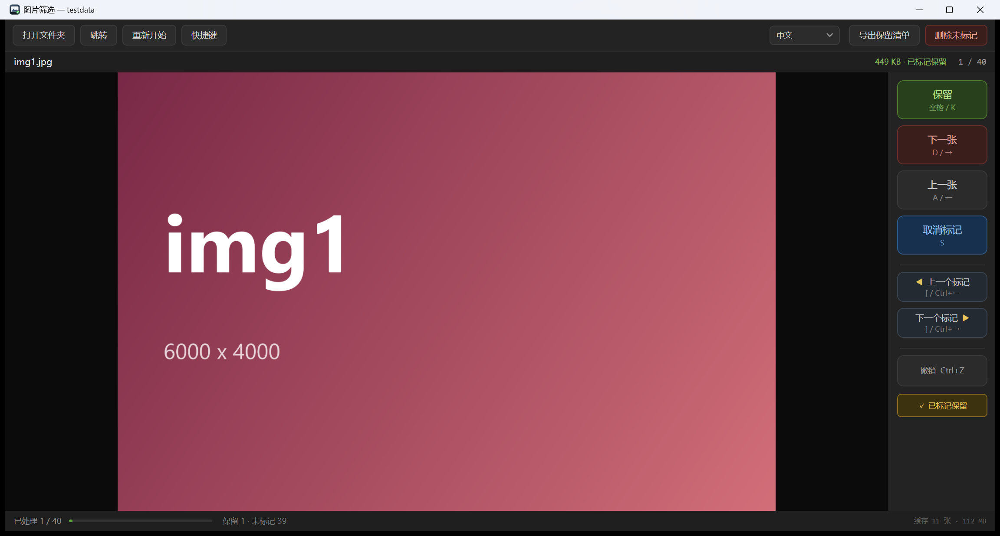

# PicSelect 画像選別

**ネットから集めた画像まとめを整理するためのツールです。** 1 回につき 1 フォルダを処理し、残したい画像に印を付けて、ひと通り見終わったら印の付いていない画像をごみ箱にまとめて移動します。

自己完結型の `.exe` 1 つ。インストール不要、ランタイム不要、ネット接続不要。

[English](README.md) · [简体中文](README.zh-CN.md) · 日本語



## 何をするツールか

1000 枚の画像をダウンロードして、使えるのが 10 枚だけ——そんなときに。画像ビューアで 1 枚ずつ開いて手作業で削除する代わりに、フォルダを一度通すだけです：

- **残す**：この画像に印を付けて次へ
- **次へ**：印を付けずに次へ
- **残す印**：印のオン／オフだけ切り替える（画像は動かない）
- 見終わったら **未選択を削除** で、印の付いていない画像をごみ箱へまとめて移動

進捗はページ送りのたびに保存されるので、途中で閉じても続きから再開できます。表示言語も記憶されます。

## 対応画像形式

| | |
|---|---|
| **対応** | `JPG` `JPEG` `PNG` `BMP` `GIF` `TIFF` `TIF` `ICO` `WebP` |
| **条件付き** | `HEIC` `HEIF` —— Microsoft Store の「HEIF 画像拡張機能」が必要 |
| **非対応** | カメラの RAW 形式（CR2、NEF、ARW、DNG など） |

`WebP` はシステムの WIC コーデックに依存し、Windows 10 1903 以降で利用できます。EXIF の向き情報がある画像は正しい向きで表示されます。サブフォルダは走査しません（1 回 1 フォルダ）。

## 特徴

- **ページ送りで引っかからない**：後ろ 10 枚、前 3 枚をバックグラウンドで先にデコードし、ページ送りはキャッシュに当たります。プレビューはウィンドウサイズに合わせて縮小デコードし、フル解像度は拡大したときだけ、こっそり差し替えます。
- **印とまとめて削除**：印の付いていない画像は `SHFileOperation` でごみ箱へ（復元可能）。削除前に件数を示す確認ダイアログが出て、失敗したファイルは個別に報告され、残りの処理は止まりません。
- **印の間を移動**：`[` / `]` で前後の最も近い印へ。端では妥当な位置にフォールバックします。
- **元に戻す**：直近 60 ステップ（印と移動）を `Ctrl+Z` で戻せます。
- **画像へ移動**：`Ctrl+G` は番号・ファイル名の一部・ワイルドカードを受け付けます。
- **本当のポータブル**：データはすべて exe と同じフォルダの `picselect.data` に。レジストリも AppData も使いません。フォルダを消せば痕跡ゼロ。
- **3 言語**：English / 中文 / 日本語 を画面から切り替え。
- **低スペックノート向けの調整**：ウィンドウサイズの自動調整、CPU コア数に応じたスレッド数、物理メモリに応じたキャッシュ上限、フル解像度デコードの長辺 4096 上限。

## 入手方法

### ダウンロード

[Releases](../../releases) から `PicSelect.exe` を取得し、任意の場所に置いてダブルクリック。Windows 10/11 x64 専用です。

### ソースからビルド

[.NET 8 SDK](https://dotnet.microsoft.com/download) が必要です。

```bash
git clone <this repo>
cd pic_select
dotnet publish src/PicSelect -c Release -r win-x64 --self-contained true -p:PublishSingleFile=true -o dist
```

`dist/PicSelect.exe`（約 64MB、自己完結）が生成されます。

## キーボード

| キー | 動作 |
|---|---|
| `スペース` / `K` | 残して次へ |
| `D` / `→` | 飛ばして次へ |
| `A` / `←` | 前の画像 |
| `S` | 印を付ける／外す（移動しない） |
| `[` / `]` | 前／次の印へ |
| `Ctrl+←` / `Ctrl+→` | 上と同じ |
| `Ctrl+Z` | 一つ戻す |
| `Ctrl+G` | 画像へ移動 |
| `Ctrl+O` | フォルダを開く |
| `Ctrl+Delete` | 未選択をすべて削除 |
| `Home` / `End` | 先頭／最後 |
| ホイール | カーソル位置を中心に拡大縮小 |
| ドラッグ | 移動 |
| `ダブルクリック` / `Enter` / `F` | ウィンドウに合わせる ↔ 100% |
| `0` | 100% |

フォルダをウィンドウにドラッグしても開けます。

## 実装の要点

C# / .NET 8 / WPF、サードパーティ依存はゼロ。

- **デコード**：`BitmapImage` + `DecodePixelWidth` で縮小プレビュー。`BitmapCacheOption.OnLoad` によりファイルハンドルを即座に解放（後で削除できる前提条件）。
- **先読み**：3 つのワーカースレッド（低コア数機では自動的に減）が優先度付きキューから取得。カーソル移動のたびに優先度を再構築し、LRU 予算でメモリを上限管理。
- **削除**：`SHFileOperationW` + `FOF_ALLOWUNDO`。1 ファイルずつ呼ぶことで失敗の原因を特定できます。
- **状態**：小さな JSON をアトミックに書き込み（`.tmp` + `File.Move`）。データベースを使わないので肥大化しません。

## データとプライバシー

すべて exe と同じフォルダの `picselect.data` に：

```
picselect.data/session.json     現在の進捗（選別完了後に自動削除）
picselect.data/settings.json    言語などの設定
picselect.data/kept_*.txt       手動で出力した一覧
```

ネット接続、レジストリ、`%AppData%` は一切使いません。別の PC へは exe をコピーするだけです。

## リポジトリ構成

```
src/PicSelect/          アプリ本体
  Core/                 デコード、キャッシュ、セッション、ごみ箱、ローカライズ
  Controls/             ズーム可能な画像ビューア
tools/GenImages/        テスト画像ジェネレーター
tools/GenIcon/          アプリアイコン生成（ベクター → マルチサイズ ICO）
docs/                   取扱説明書（英/中/日）とスクリーンショット
```

`testdata/` とビルド成果物はコミットしていません。サンプル画像が必要なときは `tools/GenImages` で再生成してください。

## ライセンス

MIT（[LICENSE](LICENSE) を参照）。
