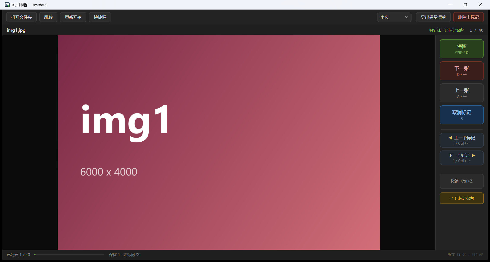

# PicSelect

**An offline image picker for cleaning up image packs.** One folder at a time: mark the images worth keeping, then after a single pass send everything unmarked to the Recycle Bin.

Single self-contained `.exe`. No installer, no runtime, no network.

English · [简体中文](README.zh-CN.md) · [日本語](README.ja.md)



## What it does

You download a pack of a thousand images and only ten of them are usable. Instead of clicking through a photo viewer and deleting files by hand, you go through the folder once:

- **Keep** marks the image and advances
- **Next** advances without marking
- **Mark** toggles the mark without moving
- When you're done, **Delete unmarked** moves everything unmarked to the Recycle Bin in one go

Progress is saved as you go, so you can close it mid-way and resume later. The language choice is remembered too.

## Supported image formats

| | |
|---|---|
| **Supported** | `JPG` `JPEG` `PNG` `BMP` `GIF` `TIFF` `TIF` `ICO` `WebP` |
| **Conditional** | `HEIC` `HEIF` — requires the *HEIF Image Extensions* package from the Microsoft Store |
| **Not supported** | Camera RAW formats (CR2, NEF, ARW, DNG, …) |

`WebP` relies on the system WIC codec and is available on Windows 10 1903 and later. Images with EXIF orientation are displayed upright. Subfolders are not scanned — one folder per run, as designed.

## Features

- **No stutter when paging.** The next 10 and previous 3 images are decoded in the background, so paging hits a warm cache. Previews are downsampled to the window size; full resolution is only decoded when you zoom in, and swapped in silently.
- **Marks and batch delete.** Unmarked images go to the Recycle Bin via `SHFileOperation`, so they can be restored. A confirmation dialog shows the exact count, and failures are reported per file without blocking the rest.
- **Jump between marked images.** `[` / `]` hops to the nearest marked image in either direction, with sensible fallbacks at the ends.
- **Undo.** The last 60 steps (marks and navigation) can be undone with `Ctrl+Z`.
- **Go to image.** `Ctrl+G` accepts a number, a file-name fragment, or a wildcard.
- **Truly portable.** Everything lives in `picselect.data` next to the exe. No registry, no AppData. Delete the folder and every trace is gone.
- **Three languages.** English / 中文 / 日本語, switchable in the UI.
- **Tuned for low-end laptops.** Adaptive window size, thread count based on CPU cores, memory budget based on physical RAM, and a 4096 px cap on full-resolution decoding.

## Getting it

### Download

Grab `PicSelect.exe` from [Releases](../../releases). Copy it anywhere and double-click. Windows 10/11 x64 only.

### Build from source

Requires the [.NET 8 SDK](https://dotnet.microsoft.com/download).

```bash
git clone <this repo>
cd pic_select
dotnet publish src/PicSelect -c Release -r win-x64 --self-contained true -p:PublishSingleFile=true -o dist
```

The result is `dist/PicSelect.exe` — about 64 MB, self-contained.

## Keyboard

| Key | Action |
|---|---|
| `Space` / `K` | Keep and go next |
| `D` / `→` | Next without marking |
| `A` / `←` | Previous image |
| `S` | Toggle mark (stays on this image) |
| `[` / `]` | Previous / next marked image |
| `Ctrl+←` / `Ctrl+→` | Same as above |
| `Ctrl+Z` | Undo last step |
| `Ctrl+G` | Go to image |
| `Ctrl+O` | Open folder |
| `Ctrl+Delete` | Delete all unmarked images |
| `Home` / `End` | First / last image |
| Wheel | Zoom around the cursor |
| Drag | Pan |
| `Double-click` / `Enter` / `F` | Fit window ↔ 100% |
| `0` | 100% |

A folder can also be dragged into the window.

## How it works

Built with C# / .NET 8 / WPF, zero third-party dependencies.

- **Decoding** — `BitmapImage` with `DecodePixelWidth` for downsampled previews, `BitmapCacheOption.OnLoad` so file handles are released immediately (a prerequisite for deleting the files later).
- **Prefetching** — three worker threads (fewer on low-core machines) pull from a priority queue rebuilt on every cursor move; an LRU budget caps memory.
- **Deletion** — `SHFileOperationW` with `FOF_ALLOWUNDO`, one file at a time so failures can be attributed precisely.
- **State** — a small JSON file written atomically (`.tmp` + `File.Move`). No database, so nothing to grow out of hand.

## Data and privacy

Everything lives in `picselect.data` next to the exe:

```
picselect.data/session.json     current progress (removed after a finished run)
picselect.data/settings.json    language preference
picselect.data/kept_*.txt       lists exported by hand
```

The tool never touches the network, the registry, or `%AppData%`. To move it to another machine, copy the exe.

## Repository layout

```
src/PicSelect/          the application
  Core/                 decoding, cache, session store, trash, localization
  Controls/             zoomable image viewer
tools/GenImages/        test-image generator
tools/GenIcon/          app icon generator (vector → multi-size ICO)
docs/                   user manuals (EN / ZH / JA) and screenshot
```

`testdata/` and build outputs are not committed; run `tools/GenImages` to regenerate sample images.

## License

MIT — see [LICENSE](LICENSE).
