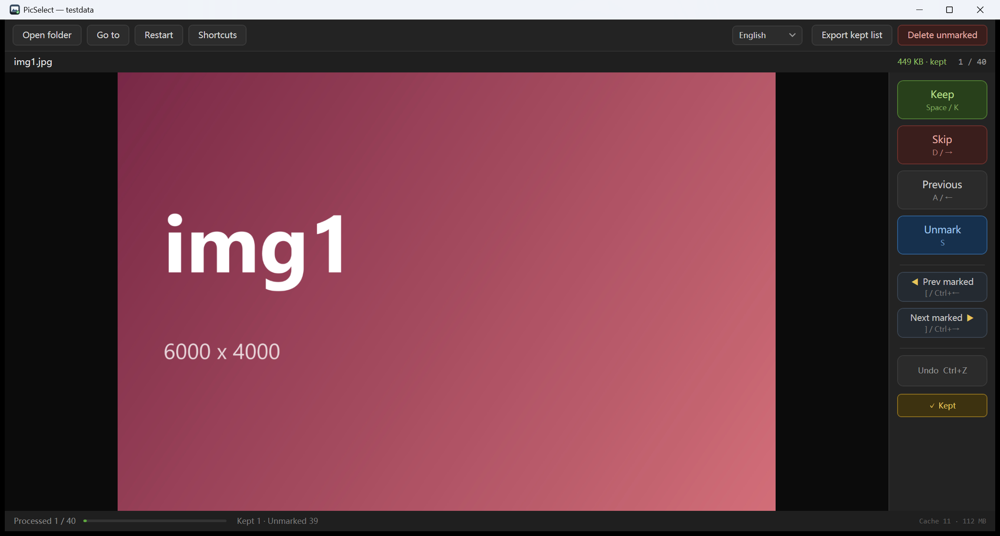

# PicSelect 图片筛选

**用来整理网上找来的图包。** 每次处理一个文件夹：看到好的图片标记好，筛选一轮后把没标记的图片都扔进回收站。

单个自包含 `.exe`，不用安装、不用运行时、不联网。

[English](README.md) · 简体中文 · [日本語](README.ja.md)



## 它是做什么的

从网上下了一千张图，能用的只有十张。与其在照片查看器里一张张点开再手动删文件，不如把这个文件夹过一遍：

- **保留**：标记这张并进入下一张
- **跳过**：不标记，直接进入下一张
- **标记保留**：只切换标记状态，画面不动
- 全部看完后点 **删除未标记**，没标记的图片一次性进回收站

进度随翻页自动保存，中途关掉可以接着来。界面语言也会记住。

## 支持的图片格式

| | |
|---|---|
| **支持** | `JPG` `JPEG` `PNG` `BMP` `GIF` `TIFF` `TIF` `ICO` `WebP` |
| **有条件支持** | `HEIC` `HEIF` —— 需要系统安装微软商店的「HEIF 图像扩展」 |
| **不支持** | 相机 RAW 格式（CR2、NEF、ARW、DNG 等） |

`WebP` 依赖系统 WIC 编解码器，Windows 10 1903 及以后一般都能读。带 EXIF 方向的图片会正着显示。不递归子文件夹——一次一个文件夹。

## 特性

- **翻页不卡**：后台提前解码后面 10 张、前面 3 张，翻页直接命中缓存。预览按窗口尺寸降采样解码；只有放大时才解全分辨率，并静默替换。
- **标记与批量删除**：未标记的图片通过 `SHFileOperation` 移入回收站，可以还原。删除前弹确认框写明数量；失败的文件单独列出，不阻塞其他文件。
- **标记间跳转**：`[` / `]` 跳到前后最近的已标记图片，两端有合理兜底。
- **撤销**：最近 60 步（标记和翻页）都能用 `Ctrl+Z` 回退。
- **跳转**：`Ctrl+G` 支持序号、文件名片段、通配符。
- **真正绿色**：所有数据都在 exe 同目录的 `picselect.data` 里，不写注册表、不写 AppData。删掉文件夹就一点痕迹都不剩。
- **三种语言**：English / 中文 / 日本語，界面内可切换。
- **面向低配笔记本**：窗口按屏幕自适应、解码线程数按 CPU 核数、内存预算按物理内存分档、全分辨率解码长边封顶 4096。

## 获取

### 下载

到 [Releases](../../releases) 下载 `PicSelect.exe`，拷到任意位置双击即可。仅支持 Windows 10/11 x64。

### 从源码构建

需要 [.NET 8 SDK](https://dotnet.microsoft.com/download)。

```bash
git clone <本仓库>
cd pic_select
dotnet publish src/PicSelect -c Release -r win-x64 --self-contained true -p:PublishSingleFile=true -o dist
```

产物是 `dist/PicSelect.exe`，约 64MB，自包含。

## 快捷键

| 按键 | 作用 |
|---|---|
| `空格` / `K` | 保留并下一张 |
| `D` / `→` | 跳过，下一张 |
| `A` / `←` | 上一张 |
| `S` | 标记 / 取消标记（不移动） |
| `[` / `]` | 上一个 / 下一个已标记 |
| `Ctrl+←` / `Ctrl+→` | 同上 |
| `Ctrl+Z` | 撤销上一步 |
| `Ctrl+G` | 跳转到指定图片 |
| `Ctrl+O` | 打开文件夹 |
| `Ctrl+Delete` | 删除所有未标记图片 |
| `Home` / `End` | 第一张 / 最后一张 |
| 滚轮 | 以鼠标位置为中心缩放 |
| 拖拽 | 平移 |
| `双击` / `Enter` / `F` | 适应窗口 ↔ 100% |
| `0` | 100% |

也可以直接把文件夹拖进窗口。

## 实现要点

C# / .NET 8 / WPF，零第三方依赖。

- **解码**：`BitmapImage` + `DecodePixelWidth` 降采样预览；`BitmapCacheOption.OnLoad` 让文件句柄立刻释放（后面能顺利删文件的前提）。
- **预取**：3 个解码线程（低核数机器自动减少）从优先级队列取任务，光标每次移动重建优先级；LRU 预算封顶内存。
- **删除**：`SHFileOperationW` + `FOF_ALLOWUNDO`，逐张调用以便精确归因失败。
- **状态**：一个小 JSON 文件，原子写（`.tmp` + `File.Move`）。没有数据库，也就不存在越用越大。

## 数据与隐私

全部在 exe 同目录的 `picselect.data`：

```
picselect.data/session.json     当前进度（筛选完成后自动删除）
picselect.data/settings.json    语言等设置
picselect.data/kept_*.txt       手动导出的清单
```

不联网、不写注册表、不写 `%AppData%`。换机器直接拷 exe。

## 目录结构

```
src/PicSelect/          应用本体
  Core/                 解码、缓存、会话存储、回收站、本地化
  Controls/             可缩放图片查看区
tools/GenImages/        测试图片生成器
tools/GenIcon/          应用图标生成器（矢量 → 多尺寸 ICO）
docs/                   使用说明（中/英/日）与截图
```

`testdata/` 和构建产物不入库，需要样图时用 `tools/GenImages` 重新生成。

## 许可

MIT，见 [LICENSE](LICENSE)。
